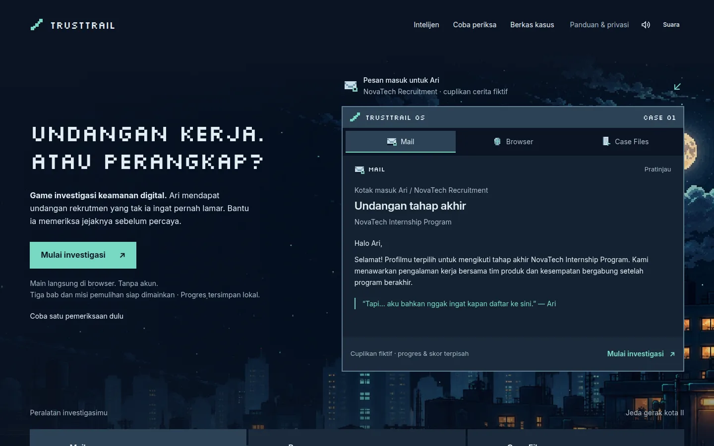
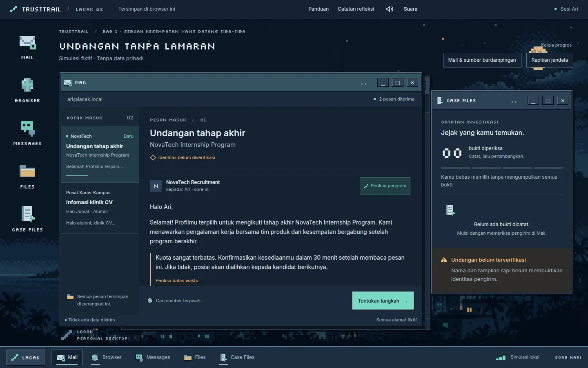
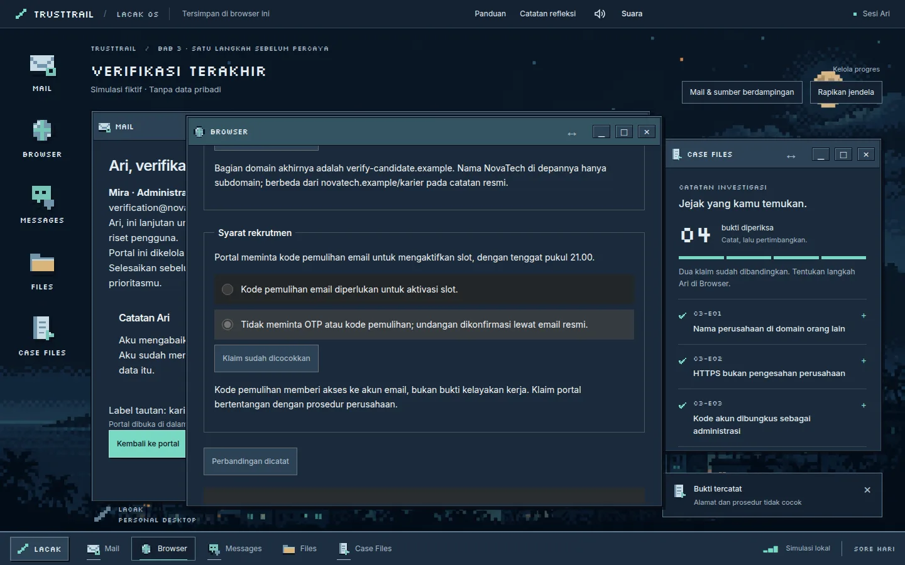
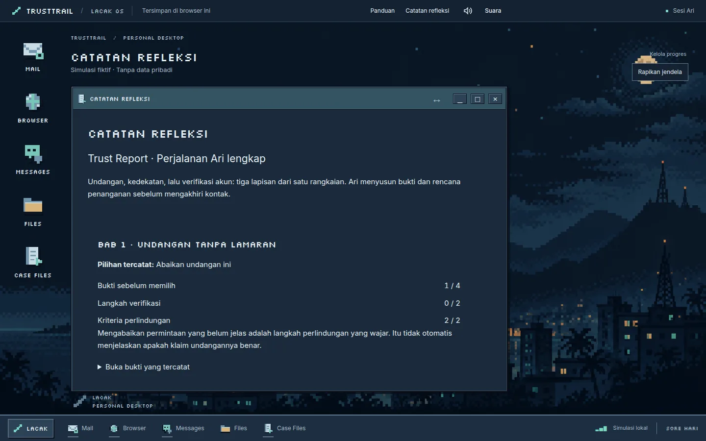
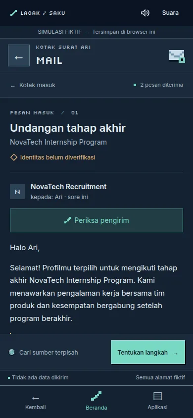
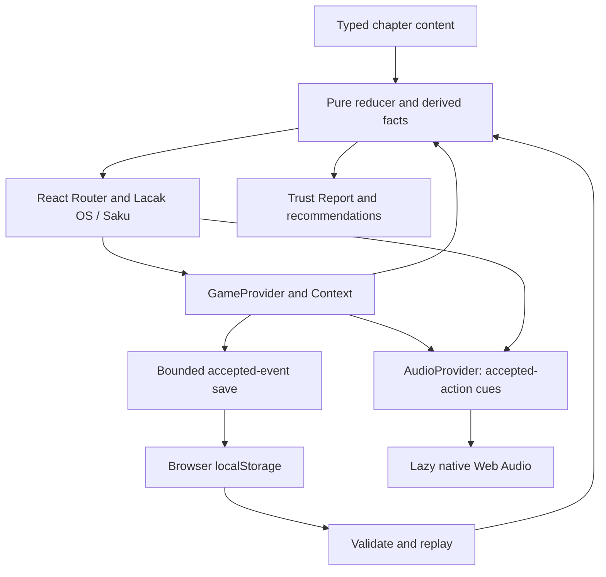
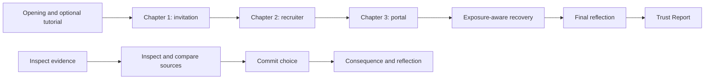

# TrustTrail

**Think Before You Trust.**

A job invitation Ari never applied for. A friendly recruiter. One final request
for an account code. TrustTrail is an Indonesian narrative investigation game
where you examine the evidence, challenge the claims, and help Ari decide what
to trust.



[](#technology)
[](#technology)
[](#technology)
[](#testing)

[](#privacy-and-security)
[](#project-and-credits)
[](#testing)

**Play locally:** `npm ci` → `npm run dev` → open `http://127.0.0.1:5173/`.
[Runtime requirements](#run-locally) · [How to play](#how-to-play) ·
[Release review](docs/final-release-readiness.md)

Phase 6 SFX-only candidate, package 0.1.0. Badges show pinned versions and the
**6 November 2026 tested snapshot**, not live CI status. No public demo URL has
been verified.

## Why investigate?

Digital deception often arrives as a believable sequence: an opportunity,
personal attention, then a request that crosses a boundary. Polished writing, a
familiar company name, or HTTPS can feel reassuring without proving who is
behind a message.

TrustTrail turns that sequence into a safe practice space. Players learn to
inspect sender and destination domains, compare claims with independently found
information, resist pressure, limit personal-data disclosure, and choose
recovery actions appropriate to the exposure. All companies, messages,
documents, codes, and deceptive destinations are fictional.

## The investigation

| Chapter                    | What Ari encounters                                    | What you practice                                                       |
| -------------------------- | ------------------------------------------------------ | ----------------------------------------------------------------------- |
| 1 · Undangan tanpa lamaran | An unexpected internship invitation                    | Sender identity, urgency, link destinations, independent career records |
| 2 · Perekrut yang ramah    | Mira's conversation and identity-document request      | Recruiter authority, channel switching, boundaries around personal data |
| 3 · Verifikasi terakhir    | A candidate portal requesting an account-recovery code | Domain ownership, the limits of HTTPS, comparing recruitment procedures |

- **Evidence before verdicts.** Inspect clues in Mail, Messages, and Browser;
  Case Files keeps the trail. Merely opening a source does not count as
  verification.
- **Consequential choices with a route forward.** Earlier decisions remain part
  of the story. Risky choices lead to recovery and reflection rather than a game
  over.
- **Recovery Mission.** Every route includes four core actions, with up to two
  additional actions for simulated account and identity exposure. Incorrect
  practice attempts can be retried.
- **Personalized Trust Report.** Review evidence known before each decision,
  verification steps, protection criteria, and recommendations drawn from the
  actions actually recorded. There is no overall ability score or certification.
- **Two investigation shells.** Lacak OS offers desktop windows; Saku offers
  mobile application navigation. Progress survives layout changes.
- **Seven original sound effects.** Native Web Audio provides short interaction
  cues, master mute, and SFX volume. No background music; essential feedback
  also appears visually.

## Inside Lacak OS and Saku

Real production-build screenshots, captured with Playwright. The report comes
from a completed mixed-risk run, including six recovery actions; its numbers are
not staged perfect results.

### Lacak OS: Mail and Case Files



### Verification: compare the portal's claims with an independent directory



### Trust Report: the choices and evidence this player recorded



### Saku: the same investigation at 390px



## How to play

1. Choose **Mulai investigasi**, open the first case, and follow Ari's opening
   story.
2. Take the optional tutorial through **Mail**, **Browser**, and **Case Files**.
   It can be skipped or replayed from **Panduan**.
3. Inspect the message, profile, or portal. Find an independent source, inspect
   its details, and explicitly compare the claims. You can decide with
   incomplete evidence.
4. Choose **Tentukan langkah**, select an action, read its consequence and
   reflection, then continue to the next chapter.
5. Complete **Misi pemulihan**, close Chapter 3, and open the **Trust Report**.
   Use **Panduan & privasi** for guidance and **Kelola progres** to manage the
   local run.

The interface and story are in Indonesian. Desktop windows appear at widths of
at least 1120px **and** heights of at least 700px; smaller or shorter viewports
use Saku. Use desktop app launchers or Saku's **Aplikasi** menu to switch tools.
One active browser tab is recommended.

## Architecture



The reducer owns legal transitions. Presentation routes select applications
without becoming the authority for progress. Saves contain accepted events;
replay reconstructs state, flags, and chapter facts. Audio is a separate
presentation service with isolated preferences, not part of scoring.



The lower chain describes each chapter's investigation loop; inspection and
comparison are optional before committing a choice. Chapter 3's consequence
leads into recovery before its final reflection. Evidence discovered after a
choice remains visible but does not retroactively improve the pre-choice record.
Recovery completion adds no arbitrary score bonus.

See [implementation architecture](docs/architecture.md),
[state contracts](docs/gameplay-state-machine.md), and
[scenario schema](docs/scenario-data-schema.md). Older planning sections in
those documents are historical; the dated implementation updates take
precedence.

## Technology

| Layer                | Implementation and reason                                                                                               |
| -------------------- | ----------------------------------------------------------------------------------------------------------------------- |
| UI                   | React 19.3.1 + TypeScript 6.0.3: typed scenario content and shared accessible controls                                  |
| Navigation and state | React Router 8.5.1 + reducer/Context: client routes with one authoritative game session                                 |
| Build and styles     | Vite 8.3.5 + Tailwind CSS 4.3.3 through PostCSS, plus authored CSS: static output and the established pixel OS identity |
| Motion and scenery   | Motion 14.8.0 + lazy PixiJS 8.22.0 city rendering, with pause/reduced-motion behavior and static fallback               |
| Audio                | Native Web Audio: seven locally synthesized effects without samples or a streaming service                              |
| Verification         | Vitest, Testing Library, Playwright, TypeScript, and ESLint                                                             |

## Privacy and security

Gameplay is **local-first**: no account, backend, analytics, upload, payment, or
real credential/OTP input. Fonts, art, and audio synthesis are local. This is
not an offline-installable/PWA claim; initial delivery still requires the host.
README badges use external Shields.io images separately from gameplay.

- `trusttrail:save:v1` holds a bounded, versioned accepted-event history. Scores
  and progress derive from validated replay. Invalid saves are preserved until
  confirmed replacement/reset; blocked storage permits memory-only play.
  Multi-tab conflicts pause writes until resolved.
- `trusttrail:audio:v2` stores mute/volume preferences, with legacy decoding;
  onboarding has its own preference key. Clearing browser storage removes local
  progress.
- Simulated `.example` destinations are inert. Fixed educational research links
  can leave the application. Future hosting providers may retain ordinary
  request logs.
- Baseline CSP restrictions, anti-framing, MIME, referrer, and capability
  headers are configured in [vercel.json](vercel.json) and mirrored in local
  production preview. The stricter script/resource CSP is **report-only**,
  because Pixi's shader generation requires compatibility review. Public header
  delivery remains unverified.
- The retained 6 November registry audits found **zero production findings** and
  **seven moderate development entries sharing one advisory**. These are dated
  observations, not a security guarantee. Fresh checks and limitations are in
  the [release review](docs/final-release-readiness.md).

Local histories are editable and provide no anti-cheat or identity assurance.
The game is educational practice, not a real-offer safety verdict. Keyboard,
focus, reduced-motion, and narrow-screen behavior have automated checks; no WCAG
conformance or screen-reader certification is claimed.

## Run locally

Use **Node 26.13.0** (`.nvmrc`) and the declared **npm 11.6.3** target.
`engines.node` permits `>=26.13.0 <27.0.0`; `engine-strict=true` is intentional.
`packageManager` records the npm target but does not switch your executable. See
[runtime selection](docs/node-26-compatibility.md#runtime-selection-and-installation).

```sh
npm ci
npm run dev
```

Open `http://127.0.0.1:5173/`. For a production build and local preview:

```sh
npm run build
npm run preview
```

Open `http://127.0.0.1:4173/`. Vercel is configured for `npm ci`,
`npm run build`, and `dist`, with SPA fallback excluding static-file paths.
Local preview does not prove public routing, TLS, headers, or caching.

## Testing

The badges retain the **6 November 2026 Phase 6 snapshot**: **137
unit/integration tests** and **152 browser tests** (76 desktop, 76 mobile), with
no failures, skips, or retries.
[Current SFX-only report and logs](docs/phase-6-audio-security-report.md). The
[final release review](docs/final-release-readiness.md) records the independent
rerun and remaining owner checks. No GitHub Actions workflow was found; these
are static evidence badges.

```sh
npm run check
npm run test:smoke
node scripts/audit-release-security.mjs
npm audit --omit=dev
npm audit
```

`check` runs TypeScript, zero-warning ESLint, unit/integration tests, and the
production build. The browser suite starts its own production preview on port
4173; stop another preview there first. Chrome is the default. For installed
Chromium:

```sh
PLAYWRIGHT_EXECUTABLE_PATH=/absolute/path/to/chromium npm run test:smoke
```

Installed Edge can use `PLAYWRIGHT_CHANNEL=msedge`. These environment-variable
examples use POSIX shell syntax. Browser tests cover Chapters 1–3, safe/risky
branches, recovery/report, onboarding, persistence, security boundaries,
keyboard navigation, SFX, and responsive layouts. The build currently warns
about an entry chunk above 500kB; no Lighthouse score or coverage percentage is
claimed.

## Project and credits

TrustTrail was developed as a solo project for **MIT-WEEK 2026**. A verified
public contributor identity has not been supplied. AI-assisted code, copy,
artwork, and original SFX provenance are documented in
[asset credits](docs/asset-credits.md); this README does not assign unsupported
individual contributions.

Inter, Silkscreen, and Space Grotesk are self-hosted with their bundled SIL Open
Font License notices. Significant software dependencies and generated artwork
are listed in the credits. The seven effects use original numerical
note/envelope definitions, not third-party recordings.

**Licensing remains an owner decision:** no project-wide license file is
present. Dependency/font licenses do not license TrustTrail's source or artwork.
The supplied city-concept reference's publication rights still require
confirmation, including its unused copy in the production output. Do not assume
public redistribution clearance from local test passes.

## Technical documentation

- [Final release readiness, blockers, and submission checklist](docs/final-release-readiness.md)
- [Current Phase 6 SFX-only implementation and security evidence](docs/phase-6-audio-security-report.md)
- [Architecture](docs/architecture.md) ·
  [Game state](docs/gameplay-state-machine.md) ·
  [Scenario schema](docs/scenario-data-schema.md)
- [Chapter 3 and recovery validation](docs/chapter-three-validation.md) ·
  [Testing strategy](docs/testing-strategy.md)
- [Asset credits and provenance](docs/asset-credits.md) ·
  [Demo video plan](docs/mit-week-demo-video-plan.md)
